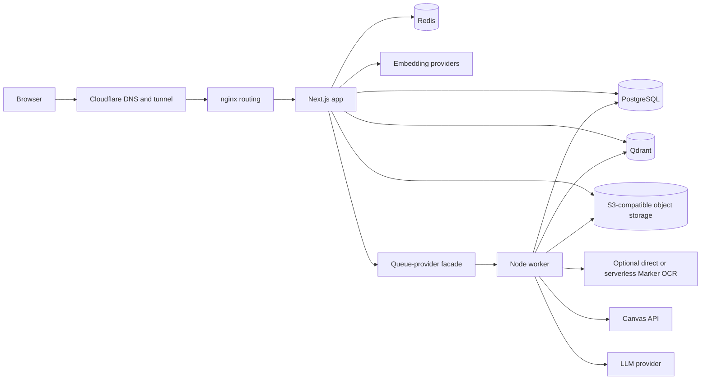

# Architecture

> **Status:** Active reference
>
> **Last reviewed:** 2026-10-16 (after the domain audit fixes landed on `dev`)
>
> **Source of truth:** Current application code, [`database/migrations/`](../../database/migrations/), and [`infra/HOMELAB.md`](../../infra/HOMELAB.md)

OghmaNotes is a Next.js App Router application with a separate long-running Node worker. The web application owns the UI, HTTP APIs, authentication, resumable chat delivery, and job submission. The worker owns LLM generation, Canvas, upload, and vault background jobs.

This page describes the running code and homelab shape. For a per-domain map of entry points, tables, keys and folders, see [Domains](domains.md). Provider migration plans belong in [`infra/TARGET_HOSTING.md`](../../infra/TARGET_HOSTING.md); operational commands belong in the operations and infrastructure runbooks.

## Runtime shape



The homelab currently runs separate prod/dev app and worker containers behind Cloudflare tunnels. Both environments share the host's stateful services but use separate databases, storage prefixes, queue prefixes, and Qdrant collections. See [`infra/HOMELAB.md`](../../infra/HOMELAB.md) for the operational topology and its isolation limits.

## Data ownership

| System | Responsibility |
|---|---|
| PostgreSQL | Users, sessions, note/tree metadata, extracted text, chunks, chat, quiz, planning, imports, and migration state |
| Qdrant | Chunk embedding vectors used by semantic search and RAG |
| S3-compatible storage | Uploaded files, note assets, exports, and other binary objects; the live app uses Cloudflare R2 (see [`infra/HOMELAB.md`](../../infra/HOMELAB.md)), and RustFS still runs on the homelab |
| Redis | BullMQ transport, short-lived replayable chat event streams, cache, and rate-limiting support |

Qdrant is the current vector store. Migration `030_qdrant_embeddings.sql` removed the old PostgreSQL `app.embeddings` table and pgvector extension after vector data moved behind [`src/lib/qdrant.ts`](../../src/lib/qdrant.ts). PostgreSQL remains the relational source of truth for chunks and their ownership.

## Note lifecycle

`app.notes` and `app.tree_items` are one relational ownership boundary. Creating
a note creates its tree row in the same transaction, and a child can only be
placed beneath an active folder owned by that user. A soft delete marks the
active tree subtree as one cohort but retains its tree rows, attachments,
annotations, chunks, and vectors. Restore can therefore reverse that operation
without recreating derived state; it restores only the matching cohort and
falls back to the root when the original parent is no longer an active folder.

Permanent trash deletion is intentionally different: it removes relational
dependents atomically and records Qdrant and private-object cleanup in a durable task.
Independently trashed descendants are retained and reparented before their
ancestor is removed. Index replacement locks the active note through its vector
write, so deletion either prevents new chunks/vectors or removes the exact set
written by the in-flight indexer. See
[`note-lifecycle.ts`](../../src/lib/notes/storage/note-lifecycle.ts) and
[`indexing.ts`](../../src/lib/rag/indexing.ts) for the executable contract.

Note and tree reads come straight from PostgreSQL. Nothing reads a server-side
Redis copy of notes, tree branches or note lists; the single-note cache served
stale content after extraction and import writes and was removed in #633.
[`tree-cache.ts`](../../src/lib/notes/tree-cache.ts) still deletes the old tree
keys after imports publish. Note save and create routes accept a larger body
than the default JSON cap (see [`note-limits.ts`](../../src/lib/notes/note-limits.ts)).

## Background work and queues

[`src/lib/queue.ts`](../../src/lib/queue.ts) is the queue-provider boundary for
the `canvas-import`, `marker-dispatch`, and BullMQ-only `chat-generation` lanes.
The `extract-retry` queue is still consumed but only drains old messages; new
retries go back onto `canvas-import`. Every BullMQ publish is bounded by
`QUEUE_PUBLISH_TIMEOUT_MS` (10 s by default), so a Redis outage fails the request
instead of hanging it. A late publish is harmless because every consumer claims
its work from PostgreSQL.

- `QUEUE_PROVIDER=bullmq` is the default and the current homelab mode. Queue names are environment-prefixed and use Redis.
- `QUEUE_PROVIDER=cloudflare` publishes and pulls through the Cloudflare Queues HTTP API. This is the migration target supported by the same worker process, not evidence that production has switched providers.
- [`src/lib/canvas/worker-entry.ts`](../../src/lib/canvas/worker-entry.ts) runs
  either BullMQ consumers or Cloudflare pull loops, plus a PostgreSQL safety
  net for Canvas import/sync discovery jobs and serverless Marker dispatches
  whose enqueue or completion handoff was lost. Its helpers live in
  [`src/lib/worker/`](../../src/lib/worker/): consumers, periodic tasks that
  never overlap themselves and log a failure instead of crashing the process,
  the heartbeat, and batched maintenance.
- The worker writes a heartbeat file every 15 s while its consumers run.
  `scripts/worker-healthcheck.ts` fails if that file is missing or older than
  60 s, so it has to run inside the worker container.

The worker handles durable LLM generation, Canvas discovery and files, direct
extraction, extraction retries, note search-index rebuilds after saves,
serverless Marker dispatch/completion, vault import/export, study-map jobs, and
the retention passes (Trash purge, deletion cleanup, cache retention, chat
payload pruning, the 30-day purge of deleted accounts). PostgreSQL and object storage remain authoritative when
Marker runs on an ephemeral provider. Vast is the ready-to-provision target,
not a live dependency; see the [Vast Marker runbook](../operations/vast-marker.md).
See [Import pipeline](import-pipeline.md) for the import processing contract
and tuning boundaries.

## Search and chat

Indexing stores chunk text and ownership in PostgreSQL, computes embeddings through the configured provider, and upserts vectors to Qdrant. Semantic search and chat embed the query, retrieve Qdrant results filtered by `user_id`, and hydrate the chunk text from PostgreSQL scoped to the same user's live notes, so ownership is checked twice. There is no reranking step; the unused rerank modules were deleted in #633, though `RERANK_*` settings remain in the env templates. Query embeddings get one 10 s attempt per endpoint so a hung provider can't stall search; indexing keeps its longer `EMBEDDING_TIMEOUT_MS` budget.

A note save does not embed inline. `PUT /api/notes/[id]` writes the row,
refuses the write with `409` when the client's `expectedUpdatedAt` is older
than the stored row, and queues a delayed, deduplicated `note-reindex` job.
The worker ([`note-reindex.ts`](../../src/lib/rag/note-reindex.ts)) reads the
content current at run time, skips notes whose `extracted_text` already
matches, and requeues itself if the row changed while embeddings were built.

Chat supports streaming and non-streaming responses. All delivery modes share
one generation preparation/finalization model; only their transport differs.
Streaming prompts are durable BullMQ jobs: the worker writes ordered SSE events
to an expiring Redis Stream while PostgreSQL owns generation state and the final
assistant message. A browser reconnect supplies the last Redis event ID,
replays missed events, and then continues live delivery. A rerun after a crash
or lease loss is detected from `started_at` and clears the replay stream with a
`reset` event. If Redis fails mid-stream, the stream route falls back to
polling PostgreSQL and still sends the terminal event. Sessions and messages
are relational data. Assistant messages retain canonical plain `content` and
optional structured `parts` for durable tool and error UI.

Redis is a required dependency for streamed chat, not merely a cache. The app
must publish the BullMQ job, the worker must consume the same environment-prefixed
queue, and the replay endpoint must read the resulting Redis Stream. Generic
app liveness remains available when Redis is degraded, while
`GET /api/health?readiness=chat` returns success only when PostgreSQL, Redis,
and the BullMQ provider are available. Worker readiness separately validates
the `chat-generation` queue. See the [chat runbook](../operations/chat.md).

Generations are cancellable. Every open browser tab heartbeats a per-user,
per-tab presence hash in Redis through [`src/lib/chat/presence.ts`](../../src/lib/chat/presence.ts)
and removes its own field with a `pagehide` beacon. A worker watchdog aborts
the LLM stream when the user explicitly stops (Redis cancel flag set by
`/api/chat/generations/[id]/cancel`) or when presence has been absent for a
full grace window — a real disconnect. In-app navigation and other open tabs
keep presence alive, so only closing the last tab (or a crash, via staleness)
cancels; users that never had browser presence, such as API clients, are only
ever cancelled explicitly. On abort the worker persists any partial answer as
an interrupted assistant message, marks the generation `cancelled`, and does
not retry. The inline SSE path aborts the same way when its client connection
drops.

The chat also has an always-available, read-only `getAppGuide` tool backed by
[`src/lib/chat/app-guide.ts`](../../src/lib/chat/app-guide.ts). It answers product
workflow, navigation, capability, and troubleshooting questions without using
the user's note index. The same guide renders the starter note created during
registration so those instructions have one source of truth.

## Localisation

The application accepts only the explicit [`Locale`](../../src/locales/index.ts)
allowlist. Server rendering resolves a valid locale from the `ogma-locale`
cookie, then `Accept-Language`, and sets the document `lang` (and Arabic
`dir="rtl"`) before content is rendered. Browser settings, cookies, and API
payloads use the same normaliser, so an invalid or stale value cannot select an
arbitrary translation module.

[`locale-data.ts`](../../src/lib/i18n/locale-data.ts) is the one dictionary
loader. It imports one allowlisted locale at a time, while the provider keeps
each rendered tree's translator isolated. Server and client both translate
through [`translate.ts`](../../src/lib/i18n/translate.ts): the locale's own key,
then English, then the key itself. A missing placeholder value renders the
placeholder instead of throwing; catalog parity and interpolation variables
are checked by `npm run i18n:audit`. That structural check does not substitute
for native-language review of translated copy.

## Canvas MCP boundary

The vendored standalone Canvas MCP defines **126 tools across 15 domains**.
OghmaNotes exposes a curated **83-tool hosted profile** (43 educator and admin
tools are disabled) through
[`src/lib/canvas/mcp.ts`](../../src/lib/canvas/mcp.ts). The profile removes many
instructor, grading, and administrative operations, but it still includes
user-scoped mutations such as submissions, messages, planner/calendar
changes, quiz attempts, and some deletes. Treat it as student-oriented, not
read-only or inherently safe. Hosted mutations create an immutable, expiring
action proposal. The signed-in owner must review its stored arguments and approve
it through the web confirmation endpoint before it runs. Chat note and planning
mutations use the same boundary; retrieved content cannot approve an action.

The hosted endpoint is [`/api/mcp/canvas`](../../src/app/api/mcp/canvas/route.ts). It requires an internal user-scoped bearer token and loads that user's stored Canvas credentials. Canvas permissions still constrain every upstream request.

- A tool runs without confirmation only if it is listed in [`tool-policy.ts`](../../src/lib/canvas/tool-policy.ts). That list is GET-only and a test enforces it.
- The internal token is HS256 with a 15 minute expiry, signed with `MCP_INTERNAL_AUTH_SECRET` or, if that is unset, a key derived from `JWT_SECRET` (so a session JWT can't stand in for it).
- The MCP Canvas client retries only GETs on a 5xx; writes are never resent. Paginated lists stop at 20 pages.

## Build, migration, and deployment

The Jenkins pipeline is the deploy authority. In outline it:

1. builds app and worker images;
2. runs the isolated integration/Playwright smoke gate;
3. keeps Qdrant available;
4. applies pending migrations through `scripts/prebuild-migrate.ts`;
5. swaps the app and worker with health checks and rollback handling;
6. runs live smoke tests before cleaning retained rollback containers and images.

`main` maps to production and `dev` maps to development. Do not encode a fixed
migration range in dependent documentation. Deployed migration state must be
checked in `app.schema_migrations`, not inferred from files alone.

## Source layout

`src/lib` groups server and shared code by domain. File names are kebab-case.

| Folder | Holds |
|---|---|
| `auth/` | Sessions and JWTs, credentials, OAuth linking, login lockout, mobile grants, agent registration, token hashing |
| `rag/` | Chunking, markdown stripping, embeddings and their provider, index writes, note reindex jobs, owned-chunk hydration |
| `marker/` | Marker OCR: direct calls, RunPod and Vast dispatch, result validation, asset output |
| `canvas/` | Canvas client and safe fetch, import pipeline (`import-*.ts`), metadata sync (`sync-*.ts`), raw export (`raw-export*.ts`), hosted MCP profile, and the worker entry (`worker-entry.ts`, `job-dispatch.ts`) |
| `worker/` | Worker helpers: queue consumers, periodic tasks, heartbeat, batched maintenance |
| `chat/` | Prompts, generation, streaming, sessions, and tool proposals that wait for approval |
| `quiz/` | FSRS scheduling, grading, question generation, session selection, streaks, dashboard |
| `vault/` | Vault ZIP import and export workers, artifact retention, job lifecycle |
| `storage/` | Object-storage contract, the S3 implementation, inline-content allowlist and key naming |
| `study-map/` | Study maps: classification jobs, topics, exam statistics, search |
| `notes/` | Browser state in `state/` (one zustand store per file, default export), browser API helpers in `api/`, server storage in `storage/` |

Shared infrastructure with one file each stays at the top of `src/lib`: `logger.ts`, `redis.ts`, `cache.ts`, `queue.ts`, `qdrant.ts`, `config.ts`, `email.ts`, `rate-limiter.ts`.

When a module grows past one file, add sibling files that share its prefix, as `canvas/import-*.ts` and `canvas/raw-export-*.ts` do. Do not add an `index.ts` barrel.

### API routes

JSON routes under `src/app/api` share one shape. The helpers live in [`src/lib/api-error.ts`](../../src/lib/api-error.ts) and [`src/lib/validations/schemas.ts`](../../src/lib/validations/schemas.ts).

```ts
export const PATCH = withErrorHandler(
  async (request, { params }: RouteParamsContext<{ id: string }>) => {
    const user = await requireAuth();
    const noteId = requireValidId((await params).id, "note ID");

    const parsed = validateBody(noteUpdateSchema, await parseJsonObject(request));
    if (!parsed.success) return parsed.response;

    const note = await updateNote(user.user_id, noteId, parsed.data);
    if (!note) return tracedError("Note not found", 404);
    return NextResponse.json(note);
  },
);
```

- `withErrorHandler` opens a trace, rejects mutating requests from an untrusted origin, and turns a thrown `ApiError` into `{ error, traceId }`. Anything else becomes a 500 with the same body shape. The class itself lives in `src/lib/api-errors.ts` so session and worker code can throw it without importing the route helpers.
- `requireAuth` checks the account and its session version in PostgreSQL on every call. `requireAuthLite` runs the same check and returns only the user id, for chat presence heartbeats.
- `parseJsonObject` reads at most 1 MiB unless told otherwise, answers malformed JSON with a 400 and an oversized body with a 413. Validate the fields with a zod schema through `validateBody`. Note routes pass a larger `maxBytes`.
- Rate limits live in [`rate-limit-config.ts`](../../src/lib/rate-limit-config.ts) as a sliding window in Redis (`MULTI`). Each rule chooses what happens when Redis is down: fall back to a per-process in-memory window, or fail closed with a 503. Auth and security rules fail closed; the login rule follows `AUTH_LOCKOUT_FAIL_OPEN`. `getClientIp` trusts the first `X-Forwarded-For` entry, which is only safe because the homelab nginx overwrites that header with `CF-Connecting-IP`.

Some routes do not use the wrapper. Webhooks and bearer-token endpoints (the RunPod callback, the internal MCP endpoint) carry no browser `Origin` header. Login, logout, register, delete-account and both mobile auth routes use the wrapper; the Android client sends `Origin` explicitly. The remaining `auth/*` routes (change-password, avatar, me, verify-email, resend-verification and the password-reset pair) still handle their own errors. Health and NextAuth handlers have their own contracts.

Sessions: [`src/proxy.ts`](../../src/proxy.ts) only checks that a session cookie is present, including chunked Auth.js cookies; it can't reach the database. For the prefixes it matches, a signed-out `/api/*` call gets a 401 JSON body and a page request is redirected to `/login`; other API routes return their own 401 from `requireAuth`. Revocation works by bumping `app.login.session_version`, which `validateSession` checks on every authenticated API call. Logout only clears cookies.

## Change discipline

Update this page in the same change when any of these boundaries move:

- relational or vector ownership;
- queue provider or worker execution model;
- app/worker deployment topology;
- hosted Canvas MCP policy;
- the high-level chat or import data flow.

Avoid hand-maintained page/API route inventories here. The filesystem is the reliable inventory.
